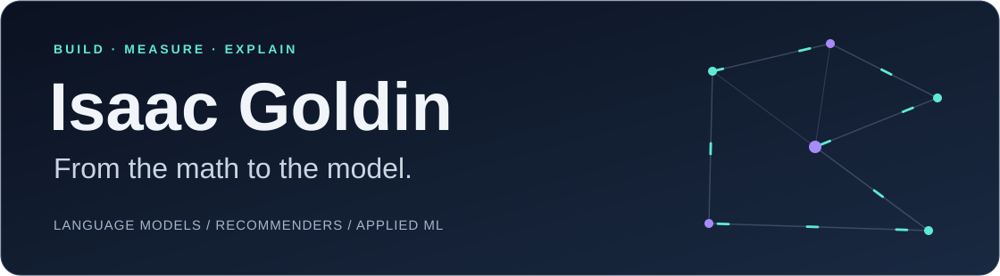
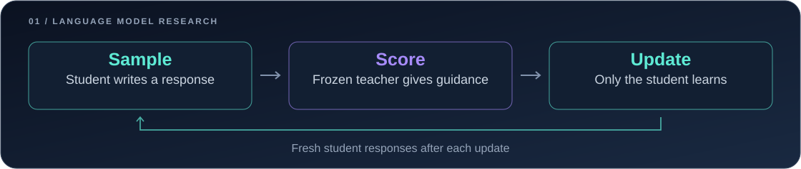
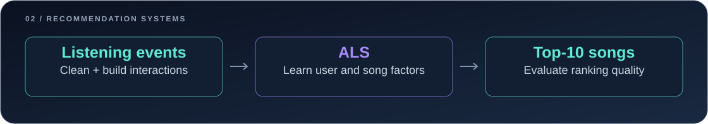
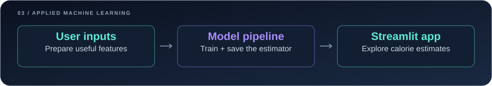

<picture>
  <source media="(prefers-reduced-motion: reduce) and (max-width: 600px)" srcset="assets/banner-mobile-static.png">
  <source media="(prefers-reduced-motion: reduce)" srcset="assets/banner-static.png">
  <source media="(max-width: 600px)" srcset="assets/banner-mobile.svg">
  
</picture>

  <strong>Pursuing a B.S. in Data Science at Rutgers University–New Brunswick</strong> 
  Computer Science track · Minors in Computer Science and Mathematics

I'm Isaac Goldin, a Rutgers Data Science student building language-model experiments, recommendation systems, and practical ML applications. I like connecting the math to working code, testing the assumptions, and explaining what the results actually show.

My projects explore different parts of that process: learning from a larger model, finding useful patterns in listening data, and turning predictions into an interface someone can use.

[Explore my repositories](https://github.com/igoldin670?tab=repositories) · [Follow the distillation experiment](https://github.com/igoldin670/on-policy-distillation/tree/dev)

## Selected work

### 01 / On-Policy Distillation

**Can a small language model learn from feedback on responses it writes itself?**

<a href="https://github.com/igoldin670/on-policy-distillation/tree/dev">
  <picture>
    <source media="(max-width: 600px)" srcset="assets/distillation-mobile.svg">
    
  </picture>
</a>

An educational adaptation of Generalized Knowledge Distillation using Qwen models. The notebooks connect token alignment and probability distributions to supervised fine-tuning, evaluation, and an on-policy training experiment with a continued-SFT comparison.

**Progress:** the supervised cold start ran on an A100. The distillation implementation is in place; its full Qwen training results are pending.

`PyTorch` · `Hugging Face` · `Qwen` · `GSM8K`

[Project & evidence](https://github.com/igoldin670/on-policy-distillation) · [Guided notebooks](https://github.com/igoldin670/on-policy-distillation/tree/dev/notebooks)

### 02 / Music Recommendation System

<a href="https://github.com/igoldin670/Music-Recommendation-System">
  <picture>
    <source media="(max-width: 600px)" srcset="assets/music-mobile.svg">
    
  </picture>
</a>

From messy interaction logs to personalized song recommendations. This project audits and cleans the data, builds implicit-feedback signals, and uses ALS matrix factorization to rank songs. A time-based holdout and ranking metrics compare personalization with a popularity baseline.

`Python` · `pandas` · `SciPy` · `implicit / ALS`

[Explore the recommendation pipeline](https://github.com/igoldin670/Music-Recommendation-System)

### 03 / TDEE Calorie Predictor

<a href="https://github.com/igoldin670/calorie-predictor">
  <picture>
    <source media="(max-width: 600px)" srcset="assets/calorie-mobile.svg">
    
  </picture>
</a>

A reproducible prediction pipeline paired with a Streamlit app. Feature engineering, preprocessing, and gradient boosting are packaged together so training and inference use the same transformations. The interface brings the model out of the notebook and makes its estimates accessible.

`scikit-learn` · `Feature engineering` · `Streamlit`

[Explore the model & app](https://github.com/igoldin670/calorie-predictor)

## Tools I work with

**Modeling:** Python · PyTorch · Transformers · scikit-learn 
**Experiments:** pandas · NumPy · Jupyter · Matplotlib 
**Applications & workflow:** Streamlit · Git · GitHub · Google Colab

I aim to make experiments inspectable: record the setup, separate implementation checks from model performance, preserve the evidence, and write explanations that help the next reader understand the decisions.

**A musical side project:** [Spotify to guitar tabs](https://github.com/igoldin670/Current-Song-Playing-Guitar-Tab), connecting the currently playing song with a guitar tab.
